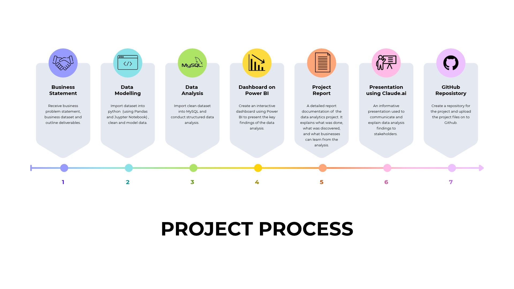
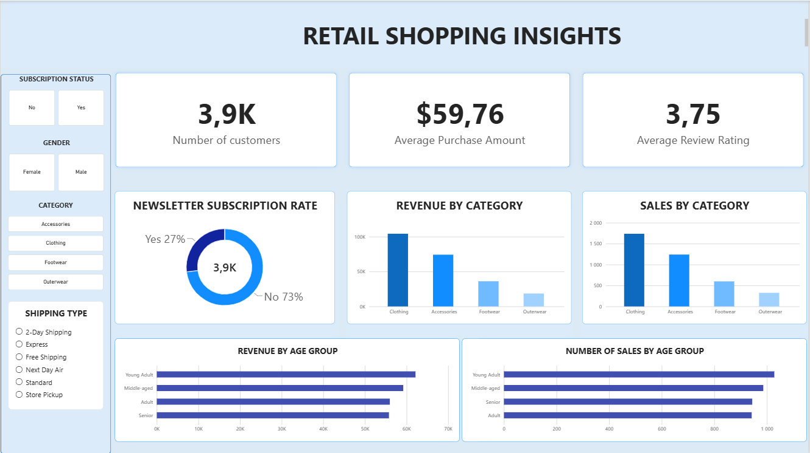

# 📊 Retail Shopping Insights

### Customer Behaviour | SQL Analysis | Power BI Dashboard

An end-to-end data analytics project exploring retail purchasing patterns,
customer spending, product preferences and discount trends using Python,
MySQL and Power BI.

The objective is to transform raw retail data into meaningful insights that can support business decision-making, improve marketing strategies and inform inventory planning.

## 🗂️ Dataset

The dataset contains 3,900 records and 18 columns covering customer demographics, purchases and shopping behaviour.

Key information includes:
- Customer age, gender and location
- Product categories, items, sizes and colours
- Purchase amounts and seasons
- Discounts and subscription status
- Shipping types and purchase frequency
- Previous purchases and product review ratings

The dataset was obtained from the original creator's GitHub repository, referenced in the Acknowledgements section below.

## 🛠️ Tools and Technologies

- Python - Data preparation and exploratory analysis
- Pandas - Data cleaning and manipulation
- Jupyter Notebook - Executing and documenting Python analysis
- MySQL - Querying data and answering business questions
- Power BI - Creating an interactive dashboard
- GitHub - Project documentation and portfolio presentation

## 📈 Key Findings

The analysis produced several findings:

- Revenue by gender: Male purchases generated 157,890 in revenue, compared with 75,191 for female purchases in the dataset.

- Subscription behaviour: Unsubscribed customers had an average purchase amount of 59.87, compared with 33.49 for subscribed customers.

- Discount usage: Hats, sneakers, coats, pants and sweaters had relatively high discount usage, with the observed rates approximately between 46% and 50%.

- Shipping preferences: The average purchase amount for express shipping was 60.48, compared with 58.46 for standard shipping.

These results describe patterns in the available dataset and do not, by themselves, establish the reasons behind customer behaviour. Revenue and spending figures are presented in the dataset's original units.

## 📊 Power BI Dashboard

The dashboard presents key retail performance indicators and visualisations to make customer and product trends easier to understand.

Dashboard preview: 

## 📁 Project Files

The repository includes the following materials:

- Python notebook containing data cleaning and exploratory analysis
- Cleaned dataset, subject to the source dataset's licence and redistribution permissions
- SQL queries used for the analysis
- Power BI dashboard file or dashboard screenshots
- Project report documenting the methodology, findings and recommendations
- Presentation summarising the project

## 🙏 Acknowledgements

This project was undertaken as a learning and portfolio exercise, using the dataset and project resources provided by Amlan Mohanty as references.

- **GitHub repository:** [Customer Trends Data Analysis — SQL, Python and Power BI](https://github.com/amlanmohanty1/customer-trends-data-analysis-SQL-Python-PowerBI)
- **YouTube tutorial:** [Customer Shopping Trends Analysis](https://www.youtube.com/watch?v=5PrZvPeUw60)

The project applies Python, MySQL and Power BI to the analysis workflow. The original creator is credited for the resources used as references.
